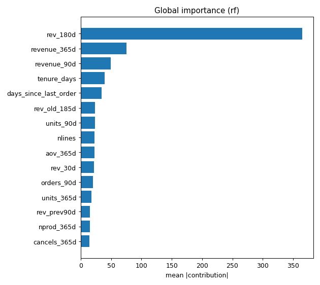
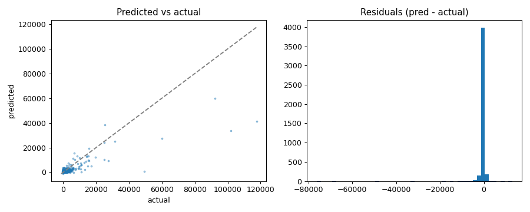

# Datus Predictive Modeling Sub-Agent

基于开源数据 Agent 框架 [Datus-agent](https://github.com/Datus-ai/Datus-agent) 二次开发的**预测建模子 Agent（gen_model）**。用户用自然语言描述预测需求，例如“预测每个客户未来 90 天的消费金额”，gen_model 按标准建模流程完成任务定义、按时间点构造特征、泄漏检查、数据切分、模型训练与评估，并交付模型说明（model card）和可重跑的训练脚本。

> 演示：gen_model 完成一次客户未来 90 天消费预测，见[运行示例](#运行示例r2-客户未来-90-天消费)。

## 目录

- [核心特性](#核心特性)
- [系统架构](#系统架构)
- [建模流程](#建模流程)
- [项目结构](#项目结构)
- [评测](#评测)
- [快速开始](#快速开始)
- [局限与后续计划](#局限与后续计划)
- [致谢与许可](#致谢与许可)

## 核心特性

- **LLM 决策，工具执行**：LLM 只负责建模决策（预测目标、时间点、切分方式、特征选择），清洗、特征计算、训练和评估由固定的 Python 工具执行。每一步决策记录在决策日志中，按同一份决策重跑可得到相同结果。
- **按时间点构造特征**：特征只使用预测时间点之前的数据，标签只使用之后的窗口。多表特征复用 Datus 的语义模型（度量、时间维）和 JOIN 路径工具自动生成 SQL，与数据分析使用同一套口径。
- **泄漏检测**：对有定义的特征做溯源检查（SQL 时间上界、滞后与滚动偏移），对无定义的列做数据检查（单特征异常强、目标可被线性还原、样本内目标编码、训练与测试实体重复）。
- **切分护栏**：根据任务类型强制匹配切分方式，包括时间切分、分组切分、多时间点快照切分和滚动回测。
- **自动调参与解释**：候选模型交叉验证后，用 FLAML 对表现最好的两个模型调参；评估包含基线对比、CV 与测试差距检查、PSI 漂移和 SHAP 解释。
- **人工确认点**：任务定义、清洗规则、最终选型三处暂停，等待用户确认后继续。
- **覆盖三类任务**：分类、回归、时间序列预测。

## 系统架构

Datus 采用“主 Agent + 子 Agent”结构，子 Agent 共用数据库连接、知识库（语义模型、指标、参考 SQL、业务规则）和工具。gen_model 作为新的子 Agent 接入：可以在网页端的子 Agent 列表中直接选择，也可以由主 Agent 在查询数据后委派。

```
                         ┌──────────────────────────────┐
     用户（网页 / CLI）──▶│           主 Agent            │
                         └──────────────┬───────────────┘
                                        │ 委派
   ┌──────────┬───────────┬─────────────┼──────────────┬──────────┬────────────┐
   ▼          ▼           ▼             ▼              ▼          ▼            ▼
 gen_sql  gen_report  gen_semantic  gen_metrics  gen_sql_summary  gen_ext   ★ gen_model
 写 SQL   归因分析     _model 语义模型  指标口径     SQL 模板       _knowledge  预测建模（本项目）
                                                                业务规则
   └──────────┴───────────┴─────────────┬──────────────┴──────────┴────────────┘
                                        ▼
               共享层：数据源连接 · 语义模型 · 指标 · JOIN 路径工具 · 知识库
```

Datus 原有的子 Agent 覆盖取数、归因分析和口径沉淀，gen_model 补上“预测未来”这一环。

共享层中的 **JOIN 路径工具**为本项目新增：根据外键、语义模型和键名建图，实测键匹配率并在必要时规范化连接条件。gen_model 用它生成多表特征 SQL；接入 gen_sql 后，在自建的 55 题多表问数评测中执行准确率由 66.7% 提升至 80%（单轮）。

## 建模流程

gen_model 按 8 个固定步骤执行，每一步的决策由 LLM 给出，计算由对应工具完成：

| 步骤 | LLM 决定 | 工具执行 | 产出 |
|---|---|---|---|
| 1. 定义任务 | 预测目标、预测单位、时间点、预测跨度、评估指标 | 校验字段与指标是否匹配任务类型 | `spec.json` |
| 2. 数据剖析 | — | 列统计、缺失、异常值、问题清单 | `profile_raw.json` |
| 3. 数据清洗 | 从规则词表中选择清洗规则 | 执行规则并记录前后行数 | `clean_log.json` |
| 4. 特征构造 | 选择特征模板和窗口 | 按时间点生成窗口 SQL、滞后与滚动特征 | `feature_meta.json` |
| 5. 数据切分 | 切分方式 | 按任务类型校验切分方式并执行 | `split.json` |
| 6. 泄漏检查 | 判断可疑特征是否剔除 | 溯源检查 + 数据检查 | `leakage.json` |
| 7. 训练选型 | 候选模型 | 交叉验证、FLAML 调参、按规则选型 | `selection.json` |
| 8. 评估导出 | 写适用范围与局限 | 测试集评估、SHAP、PSI、导出 | `model_card.md`、`recipe.json`、`train.py`、`score.py` |

第 1、3、7 步结束后暂停，等待用户确认。所有决策及理由写入 `decisions.jsonl`。

## 项目结构

只列出本项目新增或修改的部分，其余为 Datus 原有代码（包名为 `dataengineer`）。

```
dataengineer/
├── agent/node/gen_model_agentic_node.py        # gen_model 子 Agent 节点
├── prompts/prompt_templates/gen_model_system_1.0.j2   # 8 步流程提示词
└── tools/
    ├── model_tools/                            # 建模工具
    │   ├── spec.py         # 任务定义与校验
    │   ├── profile.py      # 数据剖析
    │   ├── clean.py        # 规则化清洗
    │   ├── features.py     # 特征模板
    │   ├── pit.py          # 按时间点取数（语义层 → 窗口 SQL）
    │   ├── split.py        # 切分与护栏
    │   ├── leakage.py      # 泄漏检测
    │   ├── train.py        # 交叉验证、FLAML 调参、选型
    │   ├── evaluate.py     # 评估、PSI、SHAP
    │   ├── export.py       # model card、recipe、训练与打分脚本
    │   └── tools.py        # 注册为 Agent 工具
    └── func_tool/join_path_tools.py            # JOIN 路径工具
eval/
├── model/build_db.py                           # 数据导入
├── model_bench/                                # 建模评测：任务定义、泄漏注入、运行与评分
├── semantic/                                   # 语义模型
├── datasets/  run_eval.py                      # 多表问数评测
subject/semantic_models/online_retail/          # 网页端使用的语义模型
tests/unit_tests/tools/model_tools/             # 单元测试
results/                                        # 评测结果汇总
```

## 评测

### 评测设计

在 6 个公开数据任务上评估 gen_model。每个任务在特征中注入若干泄漏字段（部分带描述，部分为名称中性、无描述的隐藏泄漏），以及同等数量的正常干扰特征。

| 任务 | 数据集 | 类型 | 指标 |
|---|---|---|---|
| C1 会话购买转化 | UCI Online Shoppers Purchasing Intention | 分类 | PR-AUC |
| C2 信用卡违约 | UCI Default of Credit Card Clients | 分类 | PR-AUC |
| R1 共享单车小时租量 | UCI Bike Sharing | 回归 | RMSE |
| R2 客户未来 90 天消费 | UCI Online Retail II | 回归 | RMSE |
| T1 Top50 商品周销量 | UCI Online Retail II | 时序 | WAPE |
| T2 用户日用电量 | UCI Electricity Load Diagrams | 时序 | WAPE |

对照组：

- **完整版**：gen_model 的全部工具和护栏
- **无护栏版**：去掉泄漏检查工具，不强制切分方式
- **纯 AutoML**：将整张表直接交给 FLAML

每组每个任务重复 3 次。评分不使用 Agent 自己报告的分数：评分脚本使用 Agent 最终的特征和模型配置，在固定测试集之外重新训练，并在测试集上把预测时无法获得的字段置空后打分，模拟上线时的输入。

**参考流程**是同一套工具在正确设定（去掉泄漏、标准滞后特征）下的结果，作为精度的参照。

### 结果

独立评分，3 次平均：

| 任务 | 指标 | 参考流程 | 完整版 | 无护栏版 | 纯 AutoML（自报 → 独立评分） |
|---|---|---|---|---|---|
| C1 | PR-AUC ↑ | 0.748 | 0.744 | 0.608 | 0.996 → 0.623 |
| C2 | PR-AUC ↑ | 0.557 | 0.555 | 0.551 | 0.997 → 0.502 |
| R1 | RMSE ↓ | 64.2 | 66.9 | 65.9 | 4.9 → 251.5 |
| R2 | RMSE ↓ | 1965 | 2032 | 2060 | 1121 → 3625 |
| T1 | WAPE ↓ | 0.686 | 0.595 | 0.496 | 0.468 → 0.708 |
| T2 | WAPE ↓ | 0.0426 | 0.045 | 0.050 | 0.016 → 0.830 |

### 结论

- **精度**：完整版与参考流程的差距中位数约 2%，T1 优于参考流程。
- **结果可信**：Agent 报告的分数与独立评分的相对差距中位数为 0。纯 AutoML 在验证集上接近满分，独立评分大幅下降，例如 C2 的 PR-AUC 从 0.997 降到 0.502，原因是它使用了泄漏字段并采用了不符合任务的切分方式。
- **泄漏检出**：完整版对带描述泄漏的检出率为 98%，对隐藏泄漏为 100%（18 次运行中均剔除）。无护栏版对隐藏泄漏的检出率也有 97%，说明 LLM 读取数据本身就能识别大部分泄漏，护栏主要提升结果的稳定性：C1 上完整版 3 次的标准差为 0.007，无护栏版为 0.228。

### 运行示例：R2 客户未来 90 天消费

下面是 R2 任务中完整版的一次运行，展示 gen_model 在各步骤做出的决策。

<!-- 演示 GIF（≤30 秒）：网页端运行本任务的录屏，待补 -->

**输入**（任务的需求描述，见 `eval/model_bench/tasks/R2_retail_customer_value.yaml`）

> 英国一家线上礼品零售商 2009-12 至 2011-12 的订单数据（发票、发票明细、商品、客户 4 张表）。请预测每个老客户（预测时点前 365 天内下过单）在预测时点之后 90 天内的净消费额（GBP），用于营销预算分配。预测时点用 2010-06-01 至 2011-09-01 每 3 个月一个。特征库里有一些现成特征可以选用。

**任务定义**：预测单位为客户，标签为时间点后 90 天的净消费额，评估指标 RMSE，基线为均值预测。共 23,584 条样本（客户 × 时间点）；Agent 选择快照切分，以最后一个时间点 2011-09-01 作为测试集（4,366 条），其余用于训练和交叉验证，并要求训练样本的标签窗口在验证时间点之前结束。

**泄漏剔除**：特征库中有 5 个由评测注入的泄漏字段，名称与正常特征相似。Agent 全部识别并剔除，同时保留了 4 个相似的正常干扰特征。

| 字段 | 剔除原因 |
|---|---|
| activity_index | 统计窗口为时间点后 90 天，与目标窗口重合 |
| recent_revenue_30d | 统计的是时间点后 30 天的消费 |
| spend_score | 窗口为时间点前后各 30 天，包含未来数据 |
| lifetime_revenue | 没有时间过滤，包含全部未来数据 |
| orders_to_date | 固定统计到 2011-12-09，对更早的时间点包含未来数据 |

剩余 17 个特征通过语义层按时间点生成（近 30/90/180/365 天消费额、订单数、商品数、距上次下单天数等），均经溯源检查确认只使用时间点之前的数据。

**模型选型**（4 折快照交叉验证）

| 模型 | CV RMSE | 标准差 |
|---|---|---|
| 均值基线 | 2067 | 429 |
| 线性回归 | 1615 | 680 |
| **随机森林（选中）** | **1323** | **290** |
| LightGBM | 1387 | 333 |
| 随机森林 + FLAML 调参 | 1370 | 301 |
| LightGBM + FLAML 调参 | 1373 | 413 |

**评估**：测试集 RMSE 2049，独立评分结果相同。测试误差比交叉验证高 55%，评估工具将其标记为“CV 与测试差距过大”；Agent 在 model card 中解释为测试时间点覆盖 9 至 11 月销售旺季，而交叉验证平均了淡季时间点，建议上线后以约 2050 作为旺季的预期误差。





<!-- 待补：model card 截图一张 -->

## 快速开始

### 环境

- Python 3.12
- [uv](https://docs.astral.sh/uv/)
- 一个 LiteLLM 支持的大模型 API（开发与评测使用 DeepSeek）

```bash
git clone <仓库地址>
cd <仓库名>
uv sync
```

### 配置

```bash
cp conf/agent.yml.example conf/agent.yml
```

在 `conf/agent.yml` 中填写模型和 API key，并添加数据源。`conf/agent.yml` 已被 `.gitignore` 忽略，请勿提交。

### 准备数据

仓库不包含数据文件。从 UCI 下载原始数据放到 `eval/model/raw/<数据集名>/`，然后导入 DuckDB：

```bash
.venv/bin/python eval/model/build_db.py online_retail_ii
```

| 数据集 | 下载地址 |
|---|---|
| Online Retail II | https://archive.ics.uci.edu/dataset/502/online+retail+ii |
| Online Shoppers Purchasing Intention | https://archive.ics.uci.edu/dataset/468/online+shoppers+purchasing+intention+dataset |
| Default of Credit Card Clients | https://archive.ics.uci.edu/dataset/350/default+of+credit+card+clients |
| Bike Sharing | https://archive.ics.uci.edu/dataset/275/bike+sharing+dataset |
| Electricity Load Diagrams（Monash 副本） | https://zenodo.org/records/4656140 |

### 启动网页端

```bash
LITELLM_LOCAL_MODEL_COST_MAP=True .venv/bin/dataengineer-cli \
  --config conf/agent.yml --datasource online_retail --web --host 127.0.0.1 --port 8501
```

打开 http://127.0.0.1:8501 ，在子 Agent 列表中选择 `gen_model`，输入预测需求。

### 复现评测

```bash
.venv/bin/python eval/model_bench/inject.py                                   # 生成注入泄漏后的任务数据
.venv/bin/python eval/model_bench/run_bench.py reference                      # 参考流程，固定测试集
.venv/bin/python eval/model_bench/run_bench.py run --round round2 --groups a,b,c --repeats 3 --workers 3
.venv/bin/python eval/model_bench/run_bench.py score --round round2           # 独立评分，输出 results.csv
```

一轮共 54 次运行。完整版单次平均约 18 分钟、约 61 万 token（Intel Mac，4 核 CPU）。

## 局限与后续计划

**局限**

- 评测数据集规模较小，建模工具将整表读入 pandas，尚未在更大规模数据上测试。
- 泄漏注入方式和评分规则为本项目设计，“置空不可得字段”是对上线场景的近似。
- 每组仅重复 3 次，且只使用了一个大模型。

**后续计划**

- **时间特征**：增加节假日与日历特征模板，改善零售、用电等有明显节日效应的时序任务。
- **文本特征**：先支持 TF-IDF + 线性模型，再接入预训练句向量或 BERT 微调（需 GPU），并补充文本专属的泄漏检查（如重复文本跨切分）。
- **大规模数据**：把特征计算下推到 DuckDB / 数据仓库，并做 10 倍规模的耗时与内存测试。
- **上线后诊断**：给定已上线模型和新数据，判断效果下滑来自分布漂移、上游字段异常还是标签延迟。

## 致谢与许可

- 本项目基于 [Datus-agent](https://github.com/Datus-ai/Datus-agent) 修改，遵循 Apache License 2.0，修改说明见 `NOTICE`。
- 数据来自 UCI Machine Learning Repository 和 Monash Time Series Forecasting Repository，均为 CC BY 4.0 许可。
